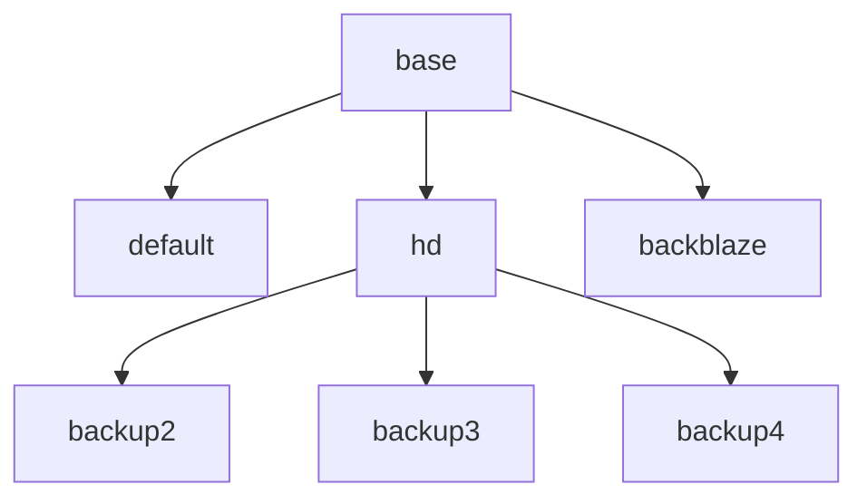

The **3-2-1 backup strategy** says: keep **3** copies of your data, on **2** different types of media, with **1** copy offsite.

This page walks through a configuration that goes further and uses a **5-3-2** setup:

* **5** repositories:
  * a fast USB-attached SSD
  * three USB-attached hard drives
  * a cloud bucket (Backblaze B2, using the S3 API)
* **3** media types: SSD, hard drive and cloud storage
* **2** offsite copies: the cloud bucket and one of the hard drives, which is kept offsite and swapped with another one every month

Each repository has **its own password**. If one key leaks, the other repositories are still encrypted and safe.

{}
A backup is only good once you have restored it. A backup you have never restored is a **Schrödinger's backup**: it may be fine or it may be broken, and you won't know until you try to restore it. Test your backups, and _especially your restore process_, regularly.
{}

## Profiles

The configuration defines 7 profiles, using [inheritance]({}) so that each one only holds what is specific to it:



| Profile     | Media            | Offsite      | `read-data-subset` | Retention          |
|-------------|------------------|--------------|--------------------|--------------------|
| `base`      | –                | –            | –                  | –                  |
| `default`   | USB SSD          | no           | 20%                | own policy         |
| `hd`        | –                | –            | 10%                | shared by HDs      |
| `backup2`   | USB hard drive   | rotated      | 10% (from `hd`)    | from `hd`          |
| `backup3`   | USB hard drive   | rotated      | 10% (from `hd`)    | from `hd`          |
| `backup4`   | USB hard drive   | rotated      | 10% (from `hd`)    | from `hd`          |
| `backblaze` | Cloud (S3 API)   | yes          | 2%                 | own policy         |

* **`base`** holds the settings every profile shares: the host name, the source directories, the exclusion patterns, and `check-after` so that every backup is followed by a `check`.
* **`default`** backs up to the fastest drive. It runs when no profile name is given on the command line.
* **`hd`** is an abstract profile. It sets the check and retention settings shared by all hard drives, but has no repository or password, so you can't run it on its own. `backup2`, `backup3` and `backup4` inherit from it and add only their repository and password.
* **`backblaze`** backs up to cloud storage. It runs unattended (for example from a scheduler) and reports to [healthchecks.io](https://healthchecks.io) through [HTTP hooks]({}).

Every profile checks a random subset of the repository data after each backup (`check --read-data-subset`). The slower or more expensive the media, the less data is read:

* With 20% on the SSD, restic has read all the data on average after about 5 backups.
* With 10% on the hard drives, it takes about 10 backups.
* Reading from cloud storage is slow and may cost money, so only 2% is read there.

## Storing the passwords

The repository passwords and the cloud credentials are never written in the configuration file. They are read from the system keychain with [`password-command`](https://restic.readthedocs.io/en/latest/030_preparing.html#repository-password). On macOS, add them with the `security` command, which prompts you to enter the password twice:

```shell
security add-generic-password -s restic -a backup_ssd -w
security add-generic-password -s restic -a backup2 -w
security add-generic-password -s restic -a backup3 -w
security add-generic-password -s restic -a backup4 -w
security add-generic-password -s restic -a backblaze -w
security add-generic-password -s restic -a bb_access_id -w
security add-generic-password -s restic -a bb_access_key -w
```

On Linux, you can use a tool such as `secret-tool` or `pass` in the same way.

The `backblaze` profile also needs the S3 access key. A `run-before` hook reads it from the keychain and writes it to the temporary dotenv file returned by the `{{env}}` [template function]({}). resticprofile then loads it into the environment of the restic command, so the key never appears in the configuration file.

## Configuration

{}
Replace the host name, source paths, volume names, bucket name and healthchecks.io UUID with your own values.
{}

```yaml
version: "1"

global:
  # Don't let the computer go to sleep in the middle of a backup
  prevent-sleep: true

# BASE profile
# ------------
# Defines what is backed up. All other profiles inherit from it.
base:
  # Set the host name for all backups. Depending on how your host name is
  # configured, it may change with your network and DHCP setup, so the
  # default value might not be stable.
  host: "my-laptop"
  backup:
    verbose: true
    source:
      - "/Users/me/Documents"
      - "/Users/me/Music"
      - "/Users/me/Pictures"
    # Exclude large intermediate files
    iexclude:
      - "*.xisf"
      - "*.ser"
    # Exclude directories that don't need a backup
    exclude:
      - "Library"
      - ".Trash"
      - ".cache"
      - ".local/share"
    # Run a check after each backup (see "read-data-subset" in each profile)
    check-after: true

# DEFAULT profile
# ---------------
# Use your fastest local drive for this profile.
# The run-before hook checks that the drive is attached, and stops with an
# error message if it isn't.
default:
  inherit: base
  repository: "local:/Volumes/BackupSSD/restic"
  run-before: "if [ -d /Volumes/BackupSSD/restic ]; then echo 'Repository is available'; else echo 'Repository is not available. *** ATTACH BackupSSD ***'; exit 1; fi"
  password-command: "security find-generic-password -s restic -a backup_ssd -w"
  check:
    # Fastest storage media: on average, all data has been checked after 5 backups
    read-data-subset: "20%"
  retention:
    after-backup: true
    keep-last: 5
    keep-within-daily: "14d"
    keep-within-weekly: "6m"
    keep-within-monthly: "2y"
    keep-yearly: "unlimited"
    prune: true

# HD profile
# ----------
# Common check and retention settings for all hard drive backups.
# The profiles below inherit from it, each one adding its own repository
# and password-command.
# You can't run this profile on its own: it has no repository or credentials.
hd:
  inherit: base
  check:
    # Slower media, so check less
    read-data-subset: "10%"
  retention:
    after-backup: true
    keep-last: 5
    keep-within-daily: "14d"
    keep-within-weekly: "6m"
    keep-within-monthly: "2y"
    keep-yearly: "unlimited"
    prune: true

backup2:
  inherit: hd
  repository: "local:/Volumes/Backup2/restic"
  run-before: "if [ -d /Volumes/Backup2/restic ]; then echo 'Repository is available'; else echo 'Repository is not available. *** ATTACH Backup2 ***'; exit 1; fi"
  password-command: "security find-generic-password -s restic -a backup2 -w"

backup3:
  inherit: hd
  repository: "local:/Volumes/Backup3/restic"
  run-before: "if [ -d /Volumes/Backup3/restic ]; then echo 'Repository is available'; else echo 'Repository is not available. *** ATTACH Backup3 ***'; exit 1; fi"
  password-command: "security find-generic-password -s restic -a backup3 -w"

backup4:
  inherit: hd
  repository: "local:/Volumes/Backup4/restic"
  run-before: "if [ -d /Volumes/Backup4/restic ]; then echo 'Repository is available'; else echo 'Repository is not available. *** ATTACH Backup4 ***'; exit 1; fi"
  password-command: "security find-generic-password -s restic -a backup4 -w"

# BACKBLAZE B2 profile
# --------------------
# Offsite backup to cloud storage, using the S3 API.
backblaze:
  inherit: base
  repository: "s3:s3.eu-central-003.backblazeb2.com/my-restic-bucket"
  password-command: "security find-generic-password -s restic -a backblaze -w"
  # Read the S3 credentials from the keychain into the restic environment
  run-before:
    - 'echo "AWS_ACCESS_KEY_ID=$(security find-generic-password -s restic -a bb_access_id -w)" >> "{{env}}"'
    - 'echo "AWS_SECRET_ACCESS_KEY=$(security find-generic-password -s restic -a bb_access_key -w)" >> "{{env}}"'
  backup:
    # Ping healthchecks.io, since this profile runs unattended.
    # send-before/send-after/send-after-fail must be nested under the
    # command they apply to (there is no profile-level equivalent).
    send-before:
      - method: HEAD
        url: "https://hc-ping.com/your-check-uuid/start"
    send-after:
      - method: HEAD
        url: "https://hc-ping.com/your-check-uuid"
    send-after-fail:
      method: POST
      url: "https://hc-ping.com/your-check-uuid/fail"
      body: "${ERROR}\n\n${ERROR_STDERR}"
      headers:
        - name: Content-Type
          value: "text/plain; charset=UTF-8"
  check:
    # Reading from cloud storage is slow and may cost money, so check only a small subset
    read-data-subset: "2%"
    # Slow internet connection: limit the number of connections to 2 (the default is 5)
    # (If the check fails, due to time-outs, try this.)
    option: "s3.connections=2"
  retention:
    after-backup: true
    keep-within-weekly: "1m"
    keep-within-monthly: "1y"
    keep-yearly: "unlimited"
    prune: true
```

{}
Use `resticprofile -n backup2 show` to see the full configuration of a profile after inheritance.
{}

## Usage

Back up to each repository. The local drives must be attached; otherwise the `run-before` hook stops the backup with a message telling you which drive to attach.

```shell
resticprofile backup
resticprofile -n backup2 backup
resticprofile -n backup3 backup
resticprofile -n backup4 backup
resticprofile -n backblaze backup
```

To run the cloud backup unattended, add a `schedule` to the `backup` section of the `backblaze` profile (see [schedules]({})).

### Test your restores

Restore the latest snapshot of each repository to a temporary location from time to time, and check the result:

```shell
resticprofile restore latest --target /tmp/restore
resticprofile -n backup2 restore latest --target /tmp/restore
resticprofile -n backblaze restore latest --target /tmp/restore
```

See the [restic documentation](https://restic.readthedocs.io/en/latest/050_restore.html) for more restore options.
